<p align="center">
  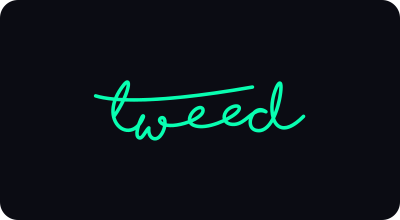
</p>

<h1 align="center">Agência Tweed · Brand Guidelines</h1>

<p align="center">
  Manual de Identidade Visual, logotipos, cores, tipografia, tokens de design, componentes e tom de voz da Agência Tweed, em tema escuro e tema claro.<br>
  <b>Versão 2.0 · Novembro 2026</b>
</p>

<p align="center">
  <a href="manual/Manual_de_Identidade_Visual_Tweed_v2.0.pdf"><b>Baixar o manual (PDF)</b></a> ·
  <a href="#logotipo">Logotipo</a> ·
  <a href="#cores">Cores</a> ·
  <a href="#tipografia">Tipografia</a> ·
  <a href="#tokens-de-design">Tokens</a> ·
  <a href="#componentes-e-linguagem-visual">Componentes</a> ·
  <a href="#tom-de-voz">Tom de voz</a> ·
  <a href="#estrutura-do-repositório">Estrutura</a>
</p>

---

## Sobre

Este repositório é a fonte oficial da identidade visual da **Agência Tweed**. Ele reúne o manual completo e todos os arquivos para aplicar a marca no site, em propostas, apresentações, redes sociais, documentos e e-mail.

O manual em PDF é a referência normativa. Se este README e o manual divergirem, vale o manual.

**O que mudou na versão 2.0.** A versão 1.0 definia três cores, uma família tipográfica, dois logotipos, os componentes decorativos e o tom de voz. A 2.0 mantém tudo isso, nos mesmos caminhos, e acrescenta medidas, escala tipográfica, superfícies, componentes, tabela de contraste, tokens prontos para código e um **tema claro completo**. Detalhes em [`CHANGELOG.md`](CHANGELOG.md).

**De onde vem cada regra.** Cada item do manual e dos tokens leva uma de três marcas:

| Marca | Significado |
|---|---|
| **Original** | Herdado do guia v1.0: Teal Tweed, Azul-Escuro, Branco, Inter, os dois logotipos, ícones de seção, fotos, tom de voz. |
| **Site** | Medido no CSS de produção do [agenciatweed.com.br](https://www.agenciatweed.com.br) (novembro de 2026): tons de apoio do escuro, escala de tipo, espaçamentos, raios, botões, cards, movimento. |
| **Proposta** | Criado nesta edição: tema claro, logotipo branco, avatar, área de proteção, tamanhos mínimos, escalas para slide, A4 e post. Vale como recomendação até a aprovação. |

O [relatório técnico](docs/relatorio-tecnico.md) registra a origem de cada valor e as verificações feitas.

## Manual de Identidade Visual

<p align="center">
  <a href="manual/Manual_de_Identidade_Visual_Tweed_v2.0.pdf">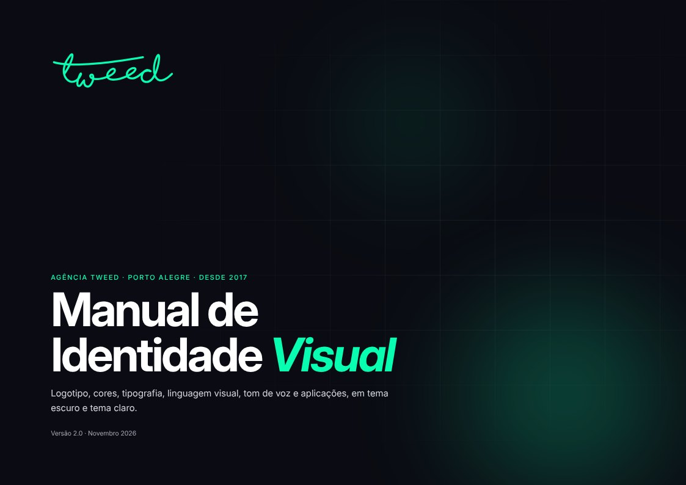</a>
</p>

📄 **[Manual_de_Identidade_Visual_Tweed_v2.0.pdf](manual/Manual_de_Identidade_Visual_Tweed_v2.0.pdf)**: 32 páginas, A4 paisagem (297 × 210 mm), texto pesquisável e fontes incorporadas.

| Capítulo | Conteúdo | Páginas |
|---|---|---|
| 01 · Fundamentos | Apresentação, crença central, sumário, os dois temas | 01–05 |
| 02 · Logotipo | Assinatura, versões de cor, proteção e tamanho, fundos, usos incorretos, avatar | 06–11 |
| 03 · Cores | Institucionais, sistema escuro, sistema claro, tokens de tema, contraste, proporção | 12–17 |
| 04 · Tipografia | Inter em três cortes, hierarquia digital, apresentações e documentos | 18–20 |
| 05 · Linguagem visual | Grid, componentes, formas e superfícies, ícones, imagem, movimento | 21–26 |
| 06 · Tom de voz | Personalidade, atributos, palavras, teste do espelho | 27 |
| 07 · Aplicações | Site, proposta no tema claro, slides e posts, checklist | 28–32 |

<table>
  <tr>
    <td>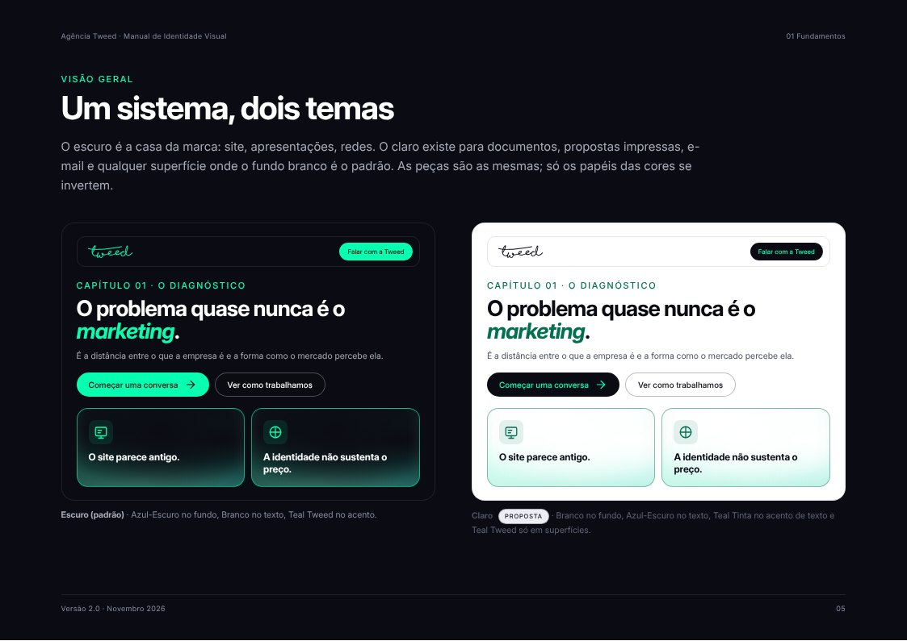</td>
    <td>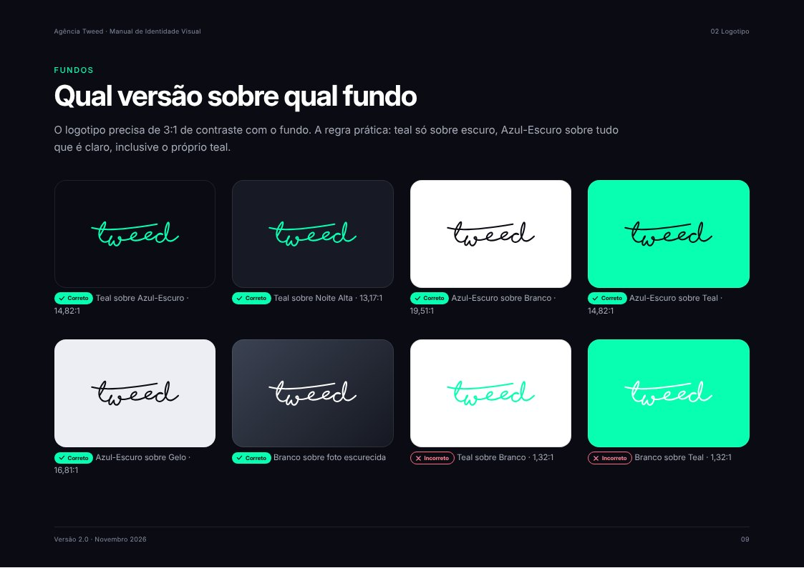</td>
    <td>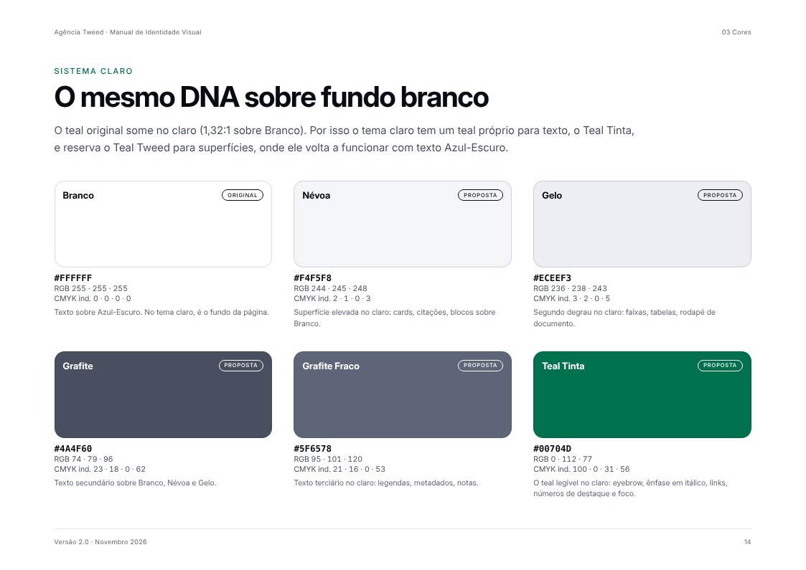</td>
  </tr>
  <tr>
    <td>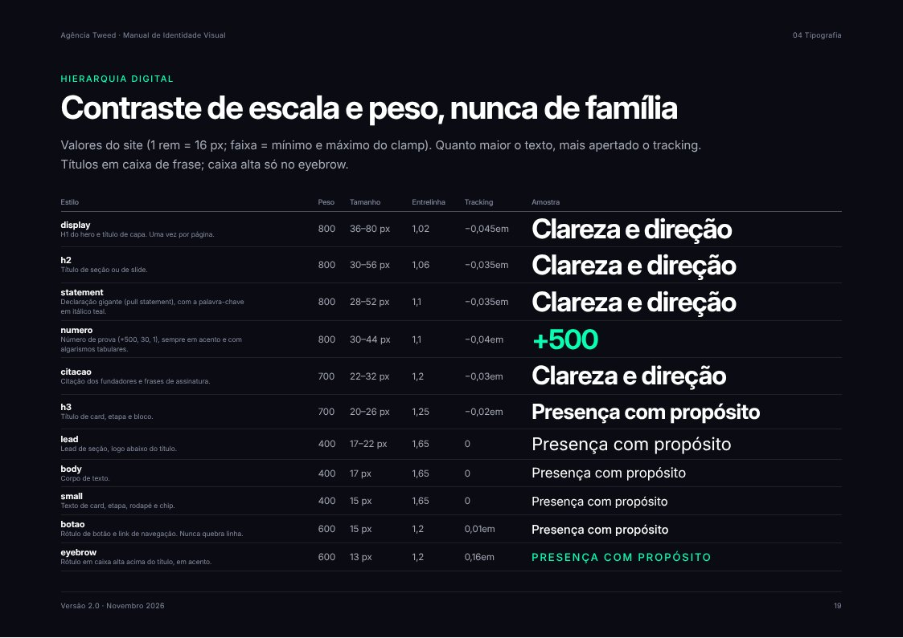</td>
    <td>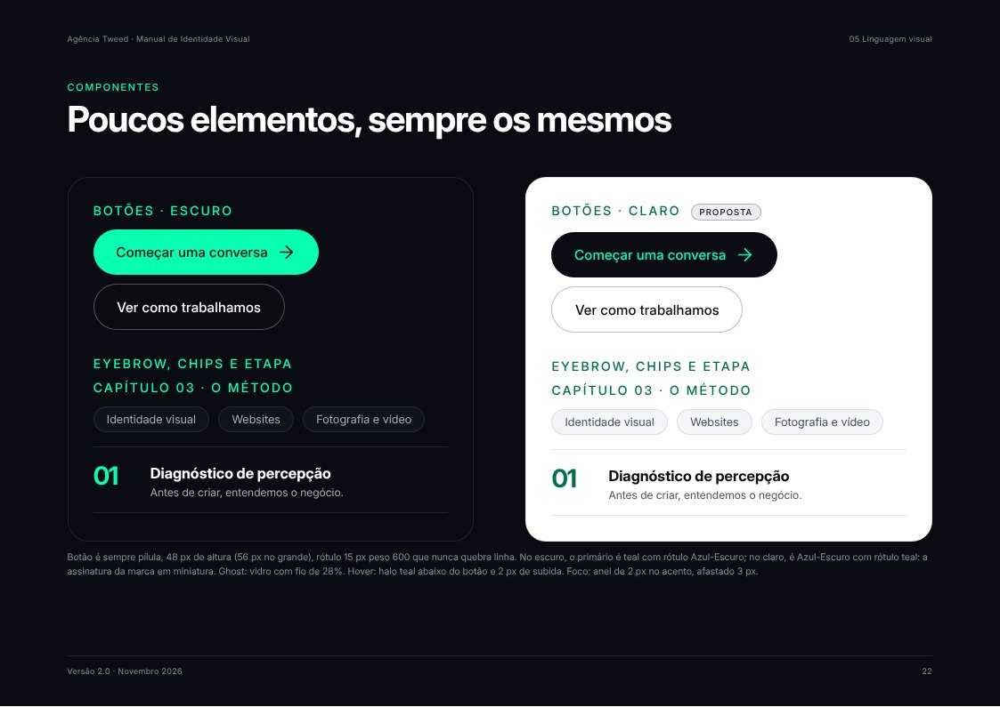</td>
    <td>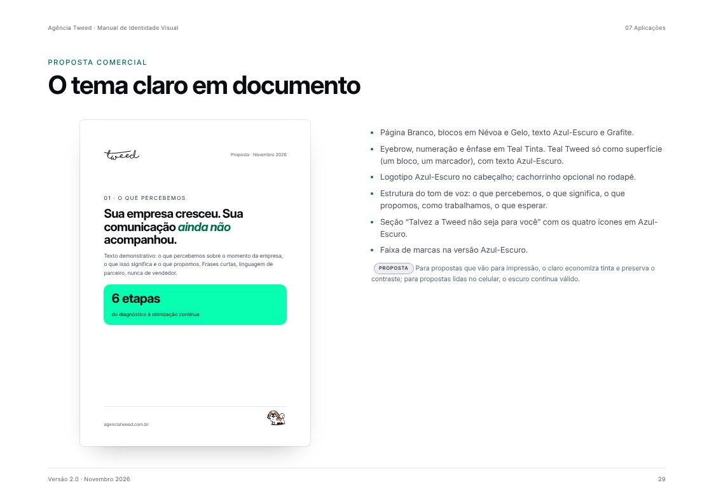</td>
  </tr>
</table>

---

## Logotipo

O logotipo é a palavra **tweed** em lettering cursivo monolinha: um traço contínuo, de espessura constante, com o corte do t estendido sobre a palavra inteira. Proporção **3,20 : 1**. Uma configuração só, em três versões de cor.

| | Versão | Origem | Uso | SVG | PNG | PDF |
|---|---|---|---|---|---|---|
|  | **Teal** | Original | Principal. Sobre Azul-Escuro, Noite e fundos escuros | [SVG](logos/logo_tweed_teal.svg) | [700 px](logos/logo_tweed_teal.png) · [2000 px](logos/png/logo_tweed_teal_2000px.png) | [RGB](logos/pdf/logo_tweed_teal_RGB.pdf) |
| 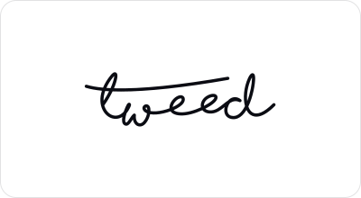 | **Azul-Escuro** | Original | Sobre Branco, Névoa, Gelo e sobre Teal Tweed | [SVG](logos/logo_tweed_azul_escuro.svg) | [700 px](logos/logo_tweed_azul_escuro.png) · [2000 px](logos/png/logo_tweed_azul_escuro_2000px.png) | [RGB](logos/pdf/logo_tweed_azul_escuro_RGB.pdf) |
| 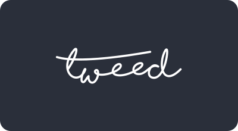 | **Branco** | Proposta | Fotografia escurecida, vídeo, impressão a uma cor | [SVG](logos/logo_tweed_branco.svg) | [700 px](logos/logo_tweed_branco.png) · [2000 px](logos/png/logo_tweed_branco_2000px.png) | [RGB](logos/pdf/logo_tweed_branco_RGB.pdf) |

**Regras essenciais** (detalhes no capítulo 02 do manual)

- **Área de proteção:** 1X em todos os lados, sendo X a altura da letra e (≈ 30% da altura do logotipo). Em capas, 2X ou mais.
- **Tamanho mínimo:** 72 px de largura em tela (104 px recomendado, como na navbar do site); 25 mm de largura em impressão.
- **Fundos:** teal só sobre escuro; Azul-Escuro sobre tudo que é claro, inclusive o próprio teal. Teal sobre Branco tem 1,32:1 e é proibido.
- **Nunca:** distorcer, girar, recolorir fora das três versões, aplicar brilho, sombra ou degradê, redigitar o nome em fonte cursiva, criar lockups com textos novos.
- **Avatar** (proposta): [`logos/avatar_tweed.svg`](logos/avatar_tweed.svg), traço teal sobre Azul-Escuro para perfis, ícone de app e favicon a partir de 48 px.

Mais detalhes em [`logos/logos.md`](logos/logos.md).

---

## Cores

### Institucionais (Original)

| Amostra | Nome | HEX | RGB | Função |
|---|---|---|---|---|
|  | **Azul-Escuro** | **#0B0C13** | 11 · 12 · 19 | Fundo padrão e espaço negativo. No claro, texto e logotipo |
|  | **Teal Tweed** | **#08FFB1** | 8 · 255 · 177 | O único acento: headline-chave, CTA, número, ênfase. Nunca texto sobre claro |
|  | **Branco** | **#FFFFFF** | 255 · 255 · 255 | Texto sobre Azul-Escuro. No claro, fundo da página |

> **Se tudo é teal, nada é destaque.** O teal é cor de tela e fica fora do gamut CMYK: em impressão, peça prova de cor ou tinta especial ao fornecedor.

### Sistema escuro (Site)

| Amostra | Nome | HEX | Função |
|---|---|---|---|
|  | Noite | `#11131C` | Superfície elevada: chips, citações, campos |
|  | Noite Alta | `#171A25` | Segundo degrau, hover de superfície |
|  | Prata | `#D3D7DF` | Texto secundário dentro de cards tingidos (13,52:1) |
|  | Cinza | `#A7ACB9` | Texto secundário sobre Azul-Escuro (8,59:1) |
|  | Cinza Fraco | `#868DA1` | Legendas, metadados, números em repouso (5,89:1) |
|  | Teal Luz | `#5CFFCB` | Hover do botão teal. Só estado |

### Sistema claro (Proposta)

| Amostra | Nome | HEX | Função |
|---|---|---|---|
|  | Branco | `#FFFFFF` | Fundo da página |
| 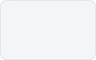 | Névoa | `#F4F5F8` | Superfície elevada: cards, citações |
| 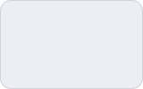 | Gelo | `#ECEEF3` | Faixas, tabelas, rodapé de documento |
|  | Azul-Escuro | `#0B0C13` | Texto principal e logotipo (19,51:1) |
|  | Grafite | `#4A4F60` | Texto secundário (8,14:1 sobre Branco) |
|  | Grafite Fraco | `#5F6578` | Legendas e metadados (5,80:1 sobre Branco) |
|  | Teal Tinta | `#00704D` | O teal legível no claro: eyebrow, ênfase, links, números (6,13:1) |

**A regra do claro:** todo teal em forma de texto, linha fina ou ícone vira **Teal Tinta**. O **Teal Tweed** continua existindo no claro, mas só como superfície (um bloco, um marcador, o rótulo do botão), sempre com Azul-Escuro em cima. O botão primário no claro é uma pílula Azul-Escuro com rótulo teal: a assinatura da marca em miniatura.

Paleta completa, contrastes e regras em [`cores/paleta-principal.md`](cores/paleta-principal.md).

---

## Tipografia

**Inter**, e só Inter, em três cortes ópticos da Inter 4. Os nomes são dos cortes, não tamanhos de corpo.

| Peso no CSS | Arquivo | Uso |
|---|---|---|
| 400 | Inter 18pt Regular (e Italic) | Corpo, lead, legendas |
| 500 · 600 | Inter 24pt Medium (e Medium Italic) | Botão, navegação, eyebrow |
| 700 · 800 | Inter 28pt Bold | Títulos, números, citações |
| 700 · 800 itálico | Inter 28pt Bold Italic | A palavra em ênfase dentro de um título |

- **Ênfase:** itálico na cor de acento (Teal Tweed no escuro, Teal Tinta no claro), uma por título.
- **Eyebrow:** 13 px, peso 600, caixa alta, tracking +0,16em, cor de acento.
- **Display:** 36 a 80 px, peso 800, tracking −0,045em. Quanto maior o texto, mais apertado.
- Arquivos TTF completos em [`tipografia/`](tipografia/) e WOFF2 do site (subconjunto latino, ~20 KB) em [`tipografia/web/`](tipografia/web/).

Escala completa (site, slide, A4 e post) em [`tipografia/fontes.md`](tipografia/fontes.md).

---

## Tokens de design

[`tokens/tweed-tokens.css`](tokens/tweed-tokens.css) traz as variáveis CSS com `@font-face`, o tema escuro como padrão e o tema claro em `[data-theme="claro"]` ou `.tweed-claro`. [`tokens/tweed-tokens.json`](tokens/tweed-tokens.json) traz os mesmos valores para ferramentas.

```css
@import "tokens/tweed-tokens.css";

body {
  background: var(--tweed-superficie);
  color: var(--tweed-texto);
  font-family: var(--tweed-font);
}

.botao-primario {                 /* teal no escuro, Azul-Escuro no claro */
  background: var(--tweed-botao-primario);
  color: var(--tweed-botao-primario-texto);
  border-radius: var(--tweed-radius-pill);
  font-weight: 600;
}

.eyebrow {                        /* Teal Tweed no escuro, Teal Tinta no claro */
  color: var(--tweed-acento);
  font-size: var(--tweed-fs-eyebrow);
  letter-spacing: .16em;
  text-transform: uppercase;
}
```

```html
<section data-theme="claro">  <!-- tudo aqui dentro troca para o tema claro -->
  <p class="tweed-eyebrow" style="color:var(--tweed-acento)">Capítulo 01 · O diagnóstico</p>
  <h2 class="tweed-h2">O problema quase nunca é o <em>marketing</em>.</h2>
</section>
```

Os tokens são gerados por [`fonte-editavel/build/tokens.py`](fonte-editavel/build/tokens.py) a partir de [`pal.py`](fonte-editavel/build/pal.py): edite a fonte e rode o script, nunca o CSS à mão.

---

## Componentes e linguagem visual

- **Botões:** sempre pílula, 48 px de altura (56 px no grande), rótulo 15 px peso 600 que nunca quebra. Primário teal com rótulo Azul-Escuro no escuro; Azul-Escuro com rótulo teal no claro. Ghost em vidro com fio de 28%. Hover: halo teal abaixo e 2 px de subida.
- **Card tingido:** raio 18 px, topo limpo para leitura e luz teal na base, com um anel de luz girando na borda. No claro, a mesma receita vira menta.
- **Eyebrow, chips, etapas numeradas, números de prova, depoimento com cinco estrelas, faixa de marcas, seção “Talvez a Tweed não seja para você”, foto dos fundadores.**
- **Raios:** 4 (foco) · 8 · 10 (ícone) · 14 (navbar) · 16 (foto) · 18 (card) · 24 (depoimento) · pílula.
- **Fios** de 1 px em alfa, nunca cinza opaco. Sem sombra externa, exceto no depoimento.
- **Ícones de interface:** traço 1,75, viewBox 24, pontas arredondadas. **Ícones de seção** só na seção deles.
- **Movimento:** uma curva só (`cubic-bezier(.16, 1, .3, 1)`), tudo desligado com `prefers-reduced-motion`.

Guia de uso de cada componente e imagem em [`componentes/componentes.md`](componentes/componentes.md). O design system no Claude traz os mesmos componentes em React, com prévias nos dois temas.

---

## Tom de voz

> **Marcas não crescem por barulho. Crescem por clareza, consistência e confiança.**

Claro, direto, confiante sem arrogância, humano e preciso: como um sócio muito bom, que pensa junto, fala claro e entrega com acabamento. O guia completo, com tom por canal, palavras do território e o teste do espelho, está em [`tom-de-voz/tom-de-voz.md`](tom-de-voz/tom-de-voz.md).

---

## Estrutura do repositório

```
brand-guidelines-tweed/
├── manual/            Manual de Identidade Visual em PDF
├── logos/             Logotipos teal e Azul-Escuro (originais), branco e avatar (propostas)
│   ├── png/           PNG transparente com 2000 px de largura
│   └── pdf/           PDF vetorial RGB
├── cores/             Paleta completa e regras
│   └── amostras/      Amostras SVG de todas as cores
├── tipografia/        Inter em TTF (seis faces)
│   └── web/           WOFF2 do site (quatro faces, subconjunto latino)
├── tokens/            Variáveis CSS e JSON, temas escuro e claro
├── componentes/       Imagens e ícones de componentes, guia de uso
├── tom-de-voz/        Guia de tom de voz
├── docs/              Relatório técnico de procedência e verificações
├── fonte-editavel/    HTML-fonte e scripts que geram o manual, os tokens e os arquivos
└── assets/previews/   Imagens usadas neste README
```

Os caminhos da versão 1.0 (`logos/logo_tweed_teal.png`, `componentes/tweed-cachorrinho-github.png`, `tipografia/inter-*.ttf` e os demais) continuam válidos: nada foi movido ou renomeado.

## Governança

- Itens marcados como **Proposta** valem como recomendação até a aprovação de Felipe Rijo e Cintia Groenwald.
- Ainda não definidos: referência Pantone ou tinta especial para o Teal Tweed, cores funcionais (sucesso, alerta, erro) e banco de imagens.
- Histórico de versões em [`CHANGELOG.md`](CHANGELOG.md).

## Licença

A marca Agência Tweed, o logotipo, o manual, as fotos e as ilustrações são propriedade da Agência Tweed e só podem ser usados conforme este manual. A Inter é distribuída sob a SIL Open Font License 1.1. Veja [`LICENSE.md`](LICENSE.md).
