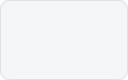

# Paleta de cores

← [Voltar ao README principal](../README.md) · Capítulo 03 do [manual](../manual/Manual_de_Identidade_Visual_Tweed_v2.0.pdf)

Três cores institucionais, um sistema de apoio para o escuro (medido no site) e um sistema para o claro (proposta desta edição). Não existe preto puro nem cinza neutro na marca: todo escuro é azul-noite e todo cinza é levemente azulado.

## Cores primárias (Original)

| Amostra | Nome | HEX | RGB | CMYK indicativo | Uso |
|---|---|---|---|---|---|
|  | **Teal Tweed** | **#08FFB1** | 8, 255, 177 | 97 · 0 · 31 · 0 | Headlines de destaque, CTAs, números, a palavra em ênfase, elementos que precisam chamar atenção sobre escuro |
|  | **Azul-Escuro** | **#0B0C13** | 11, 12, 19 | 42 · 37 · 0 · 93 | Backgrounds e espaço negativo; no claro, texto e logotipo |
|  | **Branco** | **#FFFFFF** | 255, 255, 255 | 0 · 0 · 0 · 0 | Texto corpo sobre Azul-Escuro; no claro, fundo da página |

Os CMYK são conversões simples e servem só de partida. O Teal Tweed está fora do gamut de quadricromia: em impressão, peça prova de cor ou tinta especial ao fornecedor. Referência Pantone ainda não definida.

**Se tudo é teal, nada é destaque.** O teal é o único acento do sistema. Nunca preenche a página inteira, nunca é decoração.

## Sistema escuro (Site)

Valores do CSS de produção do agenciatweed.com.br.

| Amostra | Nome | HEX | Uso | Contraste |
|---|---|---|---|---|
|  | Noite | `#11131C` | Superfície elevada: chips, citações, campos | Branco sobre ela 18,52:1 |
|  | Noite Alta | `#171A25` | Segundo degrau, hover de superfície | Cinza sobre ela 7,63:1 |
|  | Prata | `#D3D7DF` | Texto secundário dentro de cards tingidos de teal | 13,52:1 sobre Azul-Escuro |
|  | Cinza | `#A7ACB9` | Leads, parágrafos de apoio, links do rodapé | 8,59:1 sobre Azul-Escuro |
|  | Cinza Fraco | `#868DA1` | Legendas, metadados, números de etapa em repouso | 5,89:1 sobre Azul-Escuro |
|  | Teal Luz | `#5CFFCB` | Hover do botão teal. Só estado, nunca cor de peça | — |

## Sistema claro (Proposta)

O Teal Tweed some sobre branco (1,32:1). O tema claro tem um teal próprio para texto, o **Teal Tinta**, e reserva o Teal Tweed para superfícies, onde ele volta a funcionar com texto Azul-Escuro.

| Amostra | Nome | HEX | Uso | Contraste |
|---|---|---|---|---|
|  | Branco | `#FFFFFF` | Fundo da página | — |
|  | Névoa | `#F4F5F8` | Cards, citações, blocos sobre Branco | — |
|  | Gelo | `#ECEEF3` | Faixas, tabelas, rodapé de documento | — |
|  | Azul-Escuro | `#0B0C13` | Texto principal, títulos, logotipo | 19,51:1 sobre Branco |
|  | Grafite | `#4A4F60` | Texto secundário | 8,14:1 sobre Branco · 7,02:1 sobre Gelo |
|  | Grafite Fraco | `#5F6578` | Legendas, metadados, notas | 5,80:1 sobre Branco · 5,00:1 sobre Gelo |
|  | Teal Tinta | `#00704D` | Eyebrow, ênfase em itálico, links, números de destaque, foco | 6,13:1 sobre Branco · 5,28:1 sobre Gelo |

### Regras do claro

- Todo teal em forma de **texto, linha fina ou ícone** é Teal Tinta.
- O **Teal Tweed** aparece no claro só como **superfície**: um bloco de destaque, um marcador, o rótulo do botão primário. Em cima dele, sempre Azul-Escuro (14,82:1).
- **Botão primário no claro:** fundo Azul-Escuro, rótulo Teal Tweed. É a assinatura da marca em miniatura.
- Logotipo sempre na versão Azul-Escuro.
- Faixa de marcas na versão [`marcas-atendidas-escuro.png`](../componentes/marcas-atendidas-escuro.png).

## Tokens de tema

Use o papel, não a cor. O mesmo nome entrega a cor certa em cada tema ([`tokens/tweed-tokens.css`](../tokens/tweed-tokens.css)).

| Token | Escuro | Claro | Uso |
|---|---|---|---|
| `--tweed-superficie` | Azul-Escuro | Branco | Fundo da página |
| `--tweed-superficie-elevada` | Noite | Névoa | Card simples, citação, chip, campo |
| `--tweed-superficie-elevada-2` | Noite Alta | Gelo | Faixas, tabelas, hover |
| `--tweed-texto` | Branco | Azul-Escuro | Texto principal e títulos |
| `--tweed-texto-suave` | Cinza | Grafite | Leads e apoio |
| `--tweed-texto-fraco` | Cinza Fraco | Grafite Fraco | Legendas e metadados |
| `--tweed-texto-tingido` | Prata | Grafite | Texto secundário em card tingido |
| `--tweed-acento` | Teal Tweed | Teal Tinta | Acento como texto |
| `--tweed-acento-forte` | Teal Tweed | Teal Tweed | Acento como superfície |
| `--tweed-botao-primario` | Teal Tweed | Azul-Escuro | Fundo do botão primário |
| `--tweed-botao-primario-texto` | Azul-Escuro | Teal Tweed | Rótulo do botão primário |
| `--tweed-fio` | branco 9% | Azul-Escuro 10% | Bordas de 1 px |
| `--tweed-foco` | Teal Tweed | Teal Tinta | Anel de foco |
| `--tweed-logo` | Teal Tweed | Azul-Escuro | Tinta do logotipo |

## Contraste (WCAG 2.x)

Texto comum precisa de 4,5:1; texto a partir de 24 px, ícones e bordas de controle, de 3:1.

| Par | Contraste | Resultado |
|---|---|---|
| Branco sobre Azul-Escuro | 19,51:1 | Passa (AAA) |
| Teal Tweed sobre Azul-Escuro | 14,82:1 | Passa (AAA) |
| Azul-Escuro sobre Teal Tweed | 14,82:1 | Passa (AAA) |
| Prata sobre Azul-Escuro | 13,52:1 | Passa (AAA) |
| Cinza sobre Azul-Escuro | 8,59:1 | Passa (AAA) |
| Cinza Fraco sobre Azul-Escuro | 5,89:1 | Passa |
| Azul-Escuro sobre Branco | 19,51:1 | Passa (AAA) |
| Grafite sobre Branco | 8,14:1 | Passa (AAA) |
| Grafite Fraco sobre Névoa | 5,32:1 | Passa |
| Teal Tinta sobre Branco | 6,13:1 | Passa |
| Teal Tinta sobre Gelo | 5,28:1 | Passa |
| **Teal Tweed sobre Branco** | **1,32:1** | **Reprova** |
| **Teal Tweed sobre Névoa** | **1,21:1** | **Reprova** |

## Proporção

- **Escuro:** Azul-Escuro ≈ 76% · Noite ≈ 10% · Branco ≈ 9% · Teal ≈ 5%.
- **Claro:** Branco ≈ 70% · Névoa e Gelo ≈ 14% · Azul-Escuro ≈ 11% · Teal ≈ 5%.

## Imagens de referência

- [Amostra do Teal Tweed](./cores_teal_tweed_08ffb1.jpg) · [Amostra do Azul-Escuro](./cores_azul_escuro_0b0c13.jpg)
- Amostras SVG de todas as cores em [`amostras/`](amostras/)
