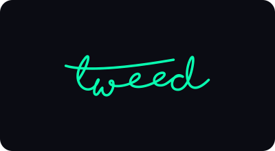
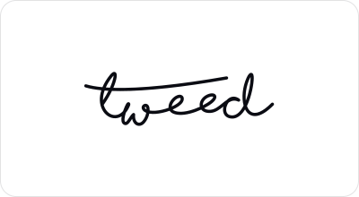
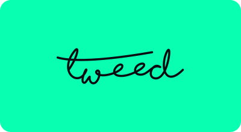
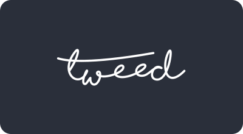

# Logotipos da Agência Tweed

← [Voltar ao README principal](../README.md) · Capítulo 02 do [manual](../manual/Manual_de_Identidade_Visual_Tweed_v2.0.pdf)

O logotipo é a palavra **tweed** em lettering cursivo monolinha: um traço contínuo, de espessura constante, com o corte do t estendido sobre a palavra inteira. Ele carrega o lado humano e autoral da agência. Proporção **3,20 : 1** (651,97 × 204,02 no vetor original). Uma configuração só, sem símbolo separado e sem descritor obrigatório.

## Versões

| Versão | Origem | Tinta | Onde usar | Arquivos |
|---|---|---|---|---|
| **Teal** (principal) | Original | `#08FFB1` | Sobre Azul-Escuro, Noite, Noite Alta e fundos escuros. É a versão do site. | [SVG](logo_tweed_teal.svg) · [PNG 700](logo_tweed_teal.png) · [PNG 2000](png/logo_tweed_teal_2000px.png) · [PDF](pdf/logo_tweed_teal_RGB.pdf) |
| **Azul-Escuro** (secundária) | Original | `#0B0C13` | Sobre Branco, Névoa, Gelo e sobre Teal Tweed. É a versão do tema claro. | [SVG](logo_tweed_azul_escuro.svg) · [PNG 700](logo_tweed_azul_escuro.png) · [PNG 2000](png/logo_tweed_azul_escuro_2000px.png) · [PDF](pdf/logo_tweed_azul_escuro_RGB.pdf) |
| **Branco** | Proposta | `#FFFFFF` | Fotografia escurecida, vídeo, impressão a uma cor (serigrafia, gravação, bordado). | [SVG](logo_tweed_branco.svg) · [PNG 700](logo_tweed_branco.png) · [PNG 2000](png/logo_tweed_branco_2000px.png) · [PDF](pdf/logo_tweed_branco_RGB.pdf) |
| **Avatar** | Proposta | Teal sobre Azul-Escuro | Foto de perfil, ícone de app, favicon a partir de 48 px. | [SVG](avatar_tweed.svg) · [PNG 512](png/avatar_tweed_512px.png) |

Os SVG teal e Azul-Escuro são os arquivos exportados do Illustrator, sem alteração. Branco, PNG de 2000 px, PDF e avatar foram gerados a partir do mesmo vetor por [`fonte-editavel/build/assets.py`](../fonte-editavel/build/assets.py): as curvas são as mesmas, só a cor muda.

**Qual arquivo usar:** SVG para web, interfaces e apresentações; PNG para Office, e-mail e ferramentas sem SVG; PDF para gráfica. O teal é cor de tela e fica fora do gamut CMYK: peça prova de cor ou tinta especial.

## Área de proteção e tamanho mínimo (Proposta)

- **X = altura da letra e** (≈ 30% da altura do logotipo). Deixe 1X livre em todos os lados; em capas e peças institucionais, 2X ou mais.
- **Tela:** mínimo de 72 px de largura (≈ 22 px de altura, como no site em celular); recomendado 104 px ou mais (navbar do site); 132 px no rodapé.
- **Impressão:** mínimo de 25 mm de largura; recomendado 35 mm ou mais.
- Abaixo desses tamanhos o traço fica mais fino que 1 px e o corte do t deixa de ser lido. Use o avatar.

## Fundos

O logotipo precisa de 3:1 de contraste com o fundo.

| Combinação | Contraste | |
|---|---|---|
| Teal sobre Azul-Escuro | 14,82:1 | ✅ |
| Teal sobre Noite Alta | 13,17:1 | ✅ |
| Azul-Escuro sobre Branco | 19,51:1 | ✅ |
| Azul-Escuro sobre Gelo | 16,81:1 | ✅ |
| Azul-Escuro sobre Teal Tweed | 14,82:1 | ✅ |
| Branco sobre fotografia escurecida | depende da foto: escureça até 4,5:1 | ✅ |
| Teal sobre Branco ou Névoa | 1,32:1 | ❌ |
| Branco sobre Teal Tweed | 1,32:1 | ❌ |

## Nunca

- Distorcer, achatar, girar ou inclinar.
- Recolorir fora das três versões, aplicar brilho, sombra, contorno ou degradê.
- Usar a versão teal sobre fundo claro.
- Aplicar sobre fundo poluído ou sem contraste.
- Redigitar o nome em fonte cursiva, vetorizar de novo a partir de imagem ou redesenhar.
- Criar lockups com textos novos (“Agência de Marketing” etc.) ou usar partes isoladas como ícone.

## Prévias

  
  
  
  

